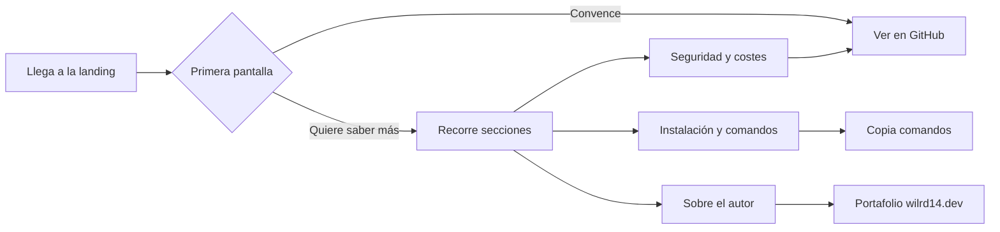

# PRD — Jarvis Landing

| Campo | Valor |
|---|---|
| Versión | 0.1 (borrador) |
| Fecha | 2026-10-21 |
| Tipo de proyecto | Web frontend (landing page estática) |
| Estado | Borrador para validación |

Fuente de la información de producto: `README.md` y el código del repositorio Jarvis (`C:/Users/willi/Code/Jarvis`, remoto `github.com/wilrd14/Jarvis`). Todo lo que la landing afirme sobre Jarvis debe poder comprobarse ahí.

## 1. Resumen ejecutivo
Jarvis Landing es la página pública que presenta **Jarvis**, un asistente de voz personal en español con núcleo holográfico que corre en el PC del propio usuario (Windows). Jarvis escucha, responde en voz alta y ejecuta acciones reales: abrir apps, crear documentos, gestionar recordatorios, analizar la pantalla y más. La landing explica qué hace, cómo se instala, cuánto cuesta usarlo y por qué es seguro, y dirige al visitante al repositorio. Su autor, William (Williams Villavizar), la usa también como pieza de portafolio.

## 2. Problema y oportunidad
- **Situación actual:** Jarvis solo se describe en un `README.md` de GitHub. Quien llega sin contexto no ve el producto en acción ni entiende rápido su propuesta.
- **Dolor:** un README es denso y poco visual; no transmite la experiencia de voz ni el diseño holográfico, que son lo más distintivo del proyecto.
- **Oportunidad:** una página rápida y cuidada que convierta el interés en visitas al repositorio, y que refuerce el portafolio del autor (`wilrd14.dev`).
- **Coste de no hacerlo:** el proyecto pasa desapercibido pese a su alcance (voz, documentos, skills, memoria, acceso móvil, seguridad).

## 3. Objetivos y métricas de éxito
| ID | Objetivo | Métrica | Meta | Cómo se mide |
|---|---|---|---|---|
| OBJ-01 | Que el visitante entienda qué es Jarvis en pocos segundos | El hero declara qué es, para quién y cuál es la acción principal sin hacer scroll | Cumple en 320 px y 1440 px de ancho | Revisión manual + prueba e2e del hero |
| OBJ-02 | Dirigir al visitante al repositorio | CTA principal visible al cargar y repetido al final | ≥ 2 apariciones del CTA a GitHub | Prueba e2e que cuenta los enlaces |
| OBJ-03 | Carga rápida y accesible | Lighthouse móvil (Rendimiento, Accesibilidad, Buenas prácticas, SEO) | ≥ 95 en las cuatro | Lighthouse CI / ejecución local |
| OBJ-04 | Información veraz | Cada afirmación sobre Jarvis tiene respaldo en su README o código | 0 afirmaciones sin respaldo | Revisión del orquestador contra `RF-xx` |

## 4. No-objetivos (fuera de alcance)
- No se construye ni se modifica Jarvis; la landing solo lo describe.
- Sin backend, base de datos, cuentas de usuario, formularios ni lista de espera.
- Sin analítica, cookies ni rastreadores en esta versión.
- Sin blog, documentación técnica completa ni páginas legales extensas.
- Sin descarga de binarios: Jarvis se instala desde el código (ver RF-10).
- Sin demo funcional en vivo de Jarvis dentro de la página (el holograma es una animación decorativa).
- Sin versión en otros idiomas en el MVP.

## 5. Usuarios y personas
**P1 — Desarrollador curioso.** Encuentra el enlace en GitHub, redes o el portafolio. Nivel técnico alto. Quiere saber qué hace, cómo está hecho (Next.js, OpenRouter, Electron) y si puede probarlo. Le frustra el marketing vacío.

**P2 — Usuario de Windows interesado en asistentes de voz.** Nivel técnico medio. Quiere un asistente en español, que corra en su equipo y haga tareas útiles. Le preocupan la privacidad, el coste y la complejidad de instalación.

**P3 — Reclutador o cliente del autor.** Llega desde el portafolio. Evalúa criterio de producto, calidad técnica y diseño en poco tiempo. Quiere ver el alcance del proyecto y contactar al autor.

## 6. Alcance del MVP
Una página de una sola URL (`/`) con: cabecera con navegación, hero con holograma animado, secciones de capacidades (voz, órdenes instantáneas, acciones sobre el PC, documentos, skills y memoria, acceso móvil), seguridad, costes, instalación, preguntas frecuentes, sobre el autor y pie de página. Optimizada para SEO, accesible y desplegable como sitio estático.

## 7. Requisitos funcionales
Todo el texto de la página está en español. Los datos se toman del `README.md` de Jarvis.

| ID | Requisito | Prioridad | Criterios de aceptación |
|---|---|---|---|
| RF-01 | **Hero.** Presenta el nombre «Jarvis», el eslogan («Asistente de voz personal con núcleo holográfico, que corre en tu propio PC»), el CTA principal «Ver en GitHub» (enlace a `https://github.com/wilrd14/Jarvis`) y un CTA secundario que lleva a «Cómo funciona/Instalación» | Must | Dado que se carga `/`, cuando se ve la primera pantalla en 375×667 y 1440×900, entonces se ven título, eslogan y el CTA principal sin scroll |
| RF-02 | **Conversación por voz.** Sección que explica: entrada automática por pausa, voz en tiempo real frase a frase, modo conversación y elección de modelo rápido/potente | Must | Dado que existe la sección con `id="voz"`, entonces contiene los cuatro puntos y ninguna afirmación ausente del README |
| RF-03 | **Órdenes instantáneas.** Sección que explica que volumen, carpetas/apps, captura, bloqueo, temporizadores, notas, hora/fecha y saludos se resuelven sin IA y sin coste | Must | Dado que existe `id="instantaneas"`, entonces lista las ocho órdenes y declara «sin IA, sin coste» |
| RF-04 | **Acciones sobre el PC y pantalla.** Sección con correo y calendario, portapapeles, buscar/abrir archivos, apps y páginas, recordatorios, alarmas, resumen del día y «¿Qué estoy viendo?» (análisis de pantalla); indica que las acciones con efecto piden confirmación | Must | Dado `id="acciones"`, entonces incluye todas las capacidades listadas y la mención de la tarjeta de confirmación |
| RF-05 | **Documentos.** Sección que lista los formatos (Word, PDF, Excel, PowerPoint, Markdown, HTML, texto, CSV), que se guardan en `Documentos\Jarvis` sin sobrescribir, y el coste estimado mostrado antes de confirmar | Must | Dado `id="documentos"`, entonces aparecen los 8 formatos y las tres afirmaciones |
| RF-06 | **Skills y memoria.** Sección que explica las skills (Markdown, 7 incluidas en español, creables desde Ajustes, nunca se ejecuta código) y la memoria a largo plazo (se puede desactivar y borrar) | Must | Dado `id="skills"`, entonces nombra las 7 skills incluidas y las dos propiedades de la memoria |
| RF-07 | **Acceso desde el celular.** Sección que explica el uso privado con Tailscale en 3 pasos, sin exponer Jarvis a internet, con PIN | Should | Dado `id="movil"`, entonces muestra los 3 pasos y aclara que las acciones se ejecutan en el PC y que el PC debe estar encendido |
| RF-08 | **Seguridad.** Sección con las garantías del README: servidor solo en loopback, validación de host/origen, lista cerrada de acciones con confirmación y firma HMAC, API keys que no salen del servidor, acceso remoto con PIN scrypt y bloqueo tras 5 intentos, documentos solo en `Documentos\Jarvis` | Must | Dado `id="seguridad"`, entonces aparecen las seis garantías redactadas en lenguaje comprensible |
| RF-09 | **Costes.** Sección que explica que todo pasa por OpenRouter y se paga por uso, que las órdenes locales cuestan 0, que existe caché de voz, saldo real y tope mensual con bloqueo | Must | Dado `id="costes"`, entonces aparecen esas cinco ideas y no hay precios inventados |
| RF-10 | **Instalación en Windows.** Sección con los pasos del README: `npm install`, `npm run app:install` (acceso directo «Jarvis», atajo Ctrl+Alt+J), pegar la API key de OpenRouter en Ajustes; cada bloque de comandos tiene botón «Copiar» | Must | Dado `id="instalacion"`, entonces los bloques de código tienen botón de copiar funcional con teclado y se anuncia «Copiado» a lectores de pantalla |
| RF-11 | **Sobre el autor y pie de página.** Bloque «Hecho por Williams Villavizar» con enlace a `https://wilrd14.dev`; pie con enlaces al repositorio y al portafolio y año | Must | Dado el pie, entonces existen ambos enlaces y abren en la misma pestaña con `rel` correcto si son externos |
| RF-12 | **Navegación.** Cabecera fija con enlaces ancla a las secciones, resaltado de sección activa y menú colapsable en móvil | Must | Dado un viewport < 768 px, cuando se pulsa el botón de menú, entonces se abre y cierra con teclado (Enter/Esc) y el foco se gestiona |
| RF-13 | **SEO y metadatos.** `title`, `description`, `lang="es"`, Open Graph y Twitter Card, imagen social, favicon y iconos, `sitemap.xml`, `robots.txt`, datos estructurados `SoftwareApplication` | Must | Dado el HTML construido, entonces todos los metadatos existen y la imagen social es de 1200×630 |
| RF-14 | **Preguntas frecuentes.** Mínimo 6 preguntas (¿Necesita internet?, ¿Cuánto cuesta?, ¿Funciona en Mac/Linux?, ¿Mis datos salen de mi PC?, ¿Qué es OpenRouter?, ¿Puedo crear mis propias skills?) respondidas con base en el README | Should | Dado `id="faq"`, entonces las respuestas son consistentes con el README y se operan con teclado |
| RF-15 | **Holograma animado.** Componente de canvas inspirado en el núcleo de Jarvis (partículas esmeralda/turquesa) escrito desde cero; respeta `prefers-reduced-motion` (imagen estática) y se pausa fuera del viewport | Must | Dado `prefers-reduced-motion: reduce`, entonces no hay animación; dada la animación fuera de pantalla, entonces `requestAnimationFrame` no se ejecuta |
| RF-16 | **CTA final.** Bloque de cierre antes del pie con el CTA principal repetido y el secundario | Should | Dado el final de la página, entonces hay un enlace a GitHub visible |

## 8. Requisitos no funcionales
| ID | Categoría | Requisito | Cómo se verifica |
|---|---|---|---|
| RNF-01 | Rendimiento | Lighthouse móvil ≥ 95 en las cuatro categorías; LCP < 2,5 s; CLS < 0,05; TBT < 200 ms | Lighthouse en `npm run build` + `preview` |
| RNF-02 | Rendimiento | JavaScript total transferido ≤ 60 KB gzip; sin librerías de runtime de terceros salvo justificación | Tamaño de `dist/` revisado en la tarea de rendimiento |
| RNF-03 | Accesibilidad | WCAG 2.1 AA: contraste ≥ 4,5:1, foco visible, navegación completa por teclado, landmarks, un solo `h1` | axe-core con Playwright: 0 violaciones; revisión manual de teclado |
| RNF-04 | Movimiento | Toda animación respeta `prefers-reduced-motion`; sin parpadeos > 3 Hz | Prueba e2e emulando la preferencia |
| RNF-05 | Responsive | Sin scroll horizontal ni solapes de 320 px a 1920 px | Pruebas Playwright en 320, 375, 768, 1024, 1440 px |
| RNF-06 | Privacidad | Sin cookies, sin rastreadores, sin peticiones a terceros en runtime (fuentes autoalojadas) | Prueba e2e que registra peticiones de red: solo mismo origen |
| RNF-07 | Seguridad | Cabeceras de seguridad (CSP restrictiva, `X-Content-Type-Options`, `Referrer-Policy`); enlaces externos con `rel="noopener noreferrer"` | Revisión de la configuración de despliegue y prueba e2e |
| RNF-08 | Compatibilidad | Últimas 2 versiones de Chrome, Edge, Firefox y Safari (incluido iOS) | Playwright (Chromium, Firefox, WebKit) |
| RNF-09 | Mantenibilidad | TypeScript estricto, lint sin errores, contenido de texto separado de los componentes | `npm run lint` y revisión |
| RNF-10 | Veracidad | Ninguna afirmación, cifra o capacidad que no esté respaldada por el README/código de Jarvis | Revisión del orquestador en cada tarea de contenido |

## 9. Historias de usuario
| ID | Historia | RF |
|---|---|---|
| HU-01 | Como desarrollador curioso, quiero ver qué hace Jarvis y su stack, para decidir si vale la pena probarlo | RF-01, RF-02, RF-04 |
| HU-02 | Como usuario de Windows, quiero saber cuánto cuesta y qué privacidad ofrece, para decidir si lo instalo | RF-08, RF-09, RF-14 |
| HU-03 | Como usuario decidido, quiero copiar los comandos de instalación, para tenerlo funcionando rápido | RF-10 |
| HU-04 | Como usuario de móvil, quiero entender cómo usar Jarvis desde el celular sin exponerlo a internet | RF-07 |
| HU-05 | Como reclutador, quiero ver quién lo hizo y llegar a su portafolio | RF-11 |
| HU-06 | Como persona con discapacidad visual o motriz, quiero navegar con teclado y lector de pantalla | RF-12, RNF-03 |
| HU-07 | Como visitante con sensibilidad al movimiento, quiero que se reduzcan las animaciones | RF-15, RNF-04 |
| HU-08 | Como visitante en móvil con conexión lenta, quiero que la página cargue rápido | RNF-01, RNF-02 |

## 10. Flujos clave

1. **Descubrimiento:** el visitante lee hero → ancla a capacidades → CTA a GitHub.
2. **Evaluación:** el visitante va a seguridad, costes y FAQ para resolver objeciones.
3. **Instalación:** el visitante va a la sección de instalación y copia los comandos.
4. **Contacto:** el visitante llega al bloque del autor y abre el portafolio.

## 11. Restricciones y supuestos
**Restricciones**
- Sitio estático (sin servidor propio), desplegable en hosting gratuito.
- Contenido solo en español en el MVP.
- La landing no debe copiar código ni recursos de terceros; el logo y los iconos son del propio proyecto Jarvis (se pueden reutilizar desde `Jarvis/public/`).
- Paleta y tipografías coherentes con Jarvis (ver Brief §5).

**Supuestos** (sin confirmar)
- El repositorio `github.com/wilrd14/Jarvis` es público o lo será antes de publicar la landing.
- No hay capturas de pantalla ni vídeo de Jarvis disponibles todavía; el MVP usa el holograma animado y maquetas hechas en HTML/CSS como ilustración.
- Jarvis solo funciona en Windows hoy (el README describe la instalación en Windows).
- El dominio final aún no existe; la URL canónica se configura al desplegar.
- El CTA principal es «Ver en GitHub» y no una descarga.

## 12. Riesgos
| ID | Riesgo | Probabilidad | Impacto | Mitigación |
|---|---|---|---|---|
| R-01 | El README de Jarvis cambia y la landing queda desactualizada | Media | Media | El contenido vive en un archivo de datos único; revisar contra el README antes de publicar |
| R-02 | Animación del holograma degrada rendimiento en móviles | Media | Alta | Límite de partículas por viewport, pausa fuera de pantalla, imagen estática con `reduced-motion` |
| R-03 | Repositorio privado: el CTA principal llevaría a un 404 | Media | Alta | Confirmar visibilidad antes de publicar (pregunta abierta Q-01) |
| R-04 | Afirmaciones exageradas o no verificables | Baja | Alta | RNF-10 y revisión por el orquestador |
| R-05 | Sin capturas reales, la página resulta abstracta | Alta | Media | Maquetas HTML/CSS de la interfaz; sustituir por capturas reales cuando existan (Q-02) |
| R-06 | CSP demasiado estricta rompe scripts inline de Astro | Media | Baja | Verificar la CSP en la tarea de despliegue con la página construida |

## 13. Roadmap por fases
| Fase | Contenido | Resultado entregable |
|---|---|---|
| 0 — Setup | Proyecto Astro + Tailwind + TypeScript, lint, pruebas unitarias y e2e | `npm run dev/test/lint/build` funcionando |
| 1 — Fundaciones | Tokens visuales, fuentes, layout base y SEO, componentes UI, cabecera, pie y estructura de secciones | Página vacía con navegación y secciones vacías |
| 2 — MVP | Holograma, hero y todas las secciones de contenido, instalación y FAQ, autor y CTA final | Landing completa en español |
| 3 — Calidad y pulido | Pruebas e2e, auditoría de accesibilidad, rendimiento y responsive | Informe de calidad sin defectos críticos |
| 4 — Release | Imagen social, sitemap, robots, cabeceras de seguridad y configuración de despliegue | Sitio listo para publicar |

## 14. Preguntas abiertas
- [ ] **Q-01:** ¿El repositorio `wilrd14/Jarvis` será público antes de publicar la landing? (decide: William)
- [ ] **Q-02:** ¿Hay capturas de pantalla o un vídeo de Jarvis para incluir? Sin ellos se usan maquetas HTML/CSS. (decide: William)
- [ ] **Q-03:** ¿Dominio previsto para la landing (por ejemplo un subdominio de `wilrd14.dev`)? Hace falta para la URL canónica y el sitemap. (decide: William)
- [ ] **Q-04:** ¿Se quiere analítica respetuosa con la privacidad (por ejemplo, contador sin cookies)? El MVP no la incluye. (decide: William)
- [ ] **Q-05:** ¿Se quiere versión en inglés más adelante? (decide: William)
- [ ] **Q-06:** ¿Hosting preferido: Vercel o Cloudflare Pages? (decide: William)

## 15. Glosario
| Término | Definición |
|---|---|
| Jarvis | Asistente de voz personal en español que corre en el PC del usuario |
| Núcleo holográfico | Animación de partículas que representa el estado de Jarvis (reposo, escuchando, pensando, hablando) |
| OpenRouter | Servicio de pago por uso a través del cual Jarvis accede a los modelos de IA |
| Skill | Instrucciones en Markdown que Jarvis aplica al redactar; nunca ejecutan código |
| Tailscale | Red privada que permite abrir Jarvis desde el celular sin exponerlo a internet |
| Órdenes instantáneas | Comandos que Jarvis resuelve localmente, sin IA y sin coste |
| Loopback | Dirección `127.0.0.1`: el servidor de Jarvis solo escucha dentro del propio equipo |
| HMAC | Firma que garantiza que una acción con efecto fue emitida por el cerebro de Jarvis |
| Isla (Astro) | Componente interactivo que carga JavaScript solo donde hace falta |
