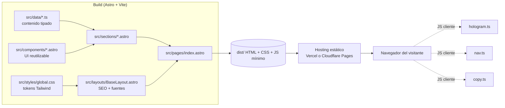

# System Architecture — Jarvis Landing

| Campo | Valor |
|---|---|
| Versión | 0.1 |
| Fecha | 2026-10-21 |
| Estilo arquitectónico | Sitio estático generado en build (Astro), organizado por secciones (feature-based) con componentes UI reutilizables |

## 1. Visión general
Jarvis Landing es un sitio estático de una sola página. Astro genera HTML y CSS en tiempo de build; el único JavaScript de cliente son tres scripts pequeños y aislados: el canvas del holograma, el menú móvil/resaltado de navegación y el botón de copiar. No hay servidor, base de datos ni APIs propias. El texto vive en archivos de datos tipados (`src/data/`) y los componentes de sección lo renderizan. El resultado (`dist/`) se publica en un hosting estático (Vercel o Cloudflare Pages, pendiente de decidir).

## 2. Estilo arquitectónico y justificación
**Elegido:** sitio estático con Astro, secciones como unidades de código y capa de contenido separada.
- **Por qué:** la landing es contenido y presentación; Astro entrega HTML sin JS por defecto, lo que favorece el rendimiento (RNF-01/02) y el SEO (RF-13).
- **Sacrificado:** menor ecosistema de componentes interactivos que React. Aceptable porque la interactividad es mínima; si crece, Astro permite añadir islas de React sin reescribir.
- **Descartado:** React + Vite (SPA): más JS y peor SEO inicial; Next.js: sobredimensionado para una página sin servidor (ver ADR-001).

## 3. Stack tecnológico
Versiones: últimas estables según `npm view` el 2026-10-21. **T-001 debe fijar versiones compatibles entre sí** (en especial TypeScript y ESLint respecto a Astro y sus plugins; si la última mayor de alguno no es compatible, usar la mayor anterior y registrarlo como ADR).

| Capa | Tecnología | Versión (referencia) | Razón |
|---|---|---|---|
| Lenguaje | TypeScript (modo `strict`) | 7.0.2 (verificar compatibilidad) | Tipado de datos de contenido y scripts |
| Framework | Astro | 7.4.2 | HTML estático, JS mínimo, islas opcionales |
| Estilos | Tailwind CSS (plugin `@tailwindcss/vite`) | 4.3.3 | Tokens en `@theme`, CSS pequeño por purga |
| Fuentes | `@fontsource-variable/*` (Space Grotesk, Geist, JetBrains Mono) | última | Autoalojadas, sin peticiones a terceros (RNF-06) |
| SEO | `@astrojs/sitemap` | 3.7.4 | `sitemap.xml` (RF-13) |
| Pruebas unitarias | Vitest | 5.0.5 | Datos de contenido, utilidades |
| Pruebas e2e | Playwright (`@playwright/test`) | 1.64.1 | Navegación, responsive, red, reduced-motion |
| Accesibilidad | `@axe-core/playwright` | 4.14.0 | RNF-03 |
| Lint / formato | ESLint (+ `eslint-plugin-astro`, `typescript-eslint`), Prettier (+ `prettier-plugin-astro`) | 10.13.0 / 3.9.10 | Reglas comprobables |
| Chequeo de tipos | `astro check` | con Astro | Tipos en `.astro` |
| Build / empaquetado | Astro (Vite) | — | Salida estática en `dist/` |
| Despliegue | Vercel o Cloudflare Pages | — | Gratuito, estático; decisión pendiente (PRD Q-06) |

No se usan: React, librerías de animación, librerías de iconos ni de UI (se evita peso y dependencias).

## 4. Diagrama de componentes


## 5. Estructura de carpetas del código
```
Jarvis-Landing/
├── docs/                      # documentación de control (no se versiona si va a GitHub)
├── .claude/                   # orquestación con Claude Code
├── public/                    # estáticos servidos tal cual
│   ├── favicon.svg · favicon.ico · apple-touch-icon.png
│   ├── og-image.png           # 1200×630
│   ├── logo.svg               # copiado desde Jarvis/public/logo.svg
│   └── robots.txt
├── src/
│   ├── pages/
│   │   └── index.astro        # compone las secciones; única página
│   ├── layouts/
│   │   └── BaseLayout.astro   # <html lang="es">, <head>, SEO, fuentes, skip-link
│   ├── sections/              # una sección de la página por archivo
│   │   ├── Hero.astro  Voice.astro  Instant.astro  Actions.astro
│   │   ├── Documents.astro  SkillsMemory.astro  Mobile.astro
│   │   ├── Security.astro  Costs.astro  Install.astro  Faq.astro
│   │   └── Author.astro  FinalCta.astro
│   ├── components/            # UI reutilizable, sin texto de negocio
│   │   ├── Button.astro  Container.astro  SectionHeading.astro
│   │   ├── Card.astro  Badge.astro  CodeBlock.astro  Steps.astro
│   │   ├── Header.astro  Footer.astro  Icon.astro
│   │   └── HologramCore.astro # markup del canvas + carga de hologram.ts
│   ├── scripts/               # TypeScript de cliente, un archivo por comportamiento
│   │   ├── hologram.ts  nav.ts  copy.ts
│   ├── data/                  # contenido tipado en español (fuente: README de Jarvis)
│   │   ├── site.ts            # nombre, URLs (GitHub, portafolio), metadatos SEO
│   │   ├── features.ts  security.ts  faq.ts  install.ts  ...
│   ├── lib/                   # utilidades puras y testeables
│   └── styles/
│       └── global.css         # @import "tailwindcss"; @theme con los tokens del Brief §5
├── tests/
│   ├── unit/                  # Vitest
│   └── e2e/                   # Playwright
├── astro.config.mjs  tsconfig.json  eslint.config.js  .prettierrc
├── playwright.config.ts  vitest.config.ts
└── package.json
```

## 6. Módulos y responsabilidades
| Módulo | Responsabilidad | Depende de | No debe depender de |
|---|---|---|---|
| `pages/` | Componer la página con las secciones | `layouts`, `sections` | `scripts` directamente, `data` directamente |
| `layouts/` | Estructura HTML, SEO, fuentes, skip-link | `components` (Header/Footer), `data/site` | `sections` |
| `sections/` | Maquetar una sección con su contenido | `components`, `data` | otras `sections`, `scripts` (salvo vía componente) |
| `components/` | UI reutilizable y accesible, sin textos de negocio | `lib`, `styles` | `sections`, `data` (reciben props) |
| `scripts/` | Comportamiento de cliente aislado | `lib` | Astro, `data`, DOM fuera de los selectores propios (`data-*`) |
| `data/` | Contenido tipado (texto en español) | solo tipos | `components`, `sections` |
| `lib/` | Funciones puras (formateo, contraste, partículas) | nada | DOM, Astro |
| `styles/` | Tokens y estilos globales | — | — |

## 7. Modelo de datos
No hay base de datos ni estado persistente. El «modelo» es el contenido tipado de `src/data/`:

```ts
interface Feature { id: string; title: string; description: string; icon: IconName; badge?: string }
interface FaqItem { question: string; answer: string }
interface InstallStep { title: string; description: string; command?: string }
interface SiteConfig {
  name: string; tagline: string; description: string; lang: 'es';
  githubUrl: string; portfolioUrl: string; canonicalUrl: string; // canonicalUrl se define al desplegar
}
```
Reglas: todo texto visible en pantalla sale de `data/`; los componentes de `components/` no contienen copia de negocio.

## 8. Contratos e interfaces
No hay API. Contratos relevantes:
- **Anclas:** `#inicio #voz #instantaneas #acciones #documentos #skills #movil #seguridad #costes #instalacion #faq #autor` (más `#cta` para el CTA final, fuera de la navegación). Son un contrato con el Brief §3 y con las pruebas e2e; no renombrar sin actualizar ambos.
- **Atributos `data-*` para scripts:** `data-hologram` (canvas), `data-nav-toggle`, `data-nav-panel`, `data-nav-link`, `data-copy` (botón) y `data-copy-source` (texto a copiar).
- **Props de componentes:** tipadas con `interface Props` en cada `.astro`.

## 9. Flujo de datos
1. En build, `index.astro` importa las secciones; cada sección importa su archivo de `data/` y renderiza con los componentes de `components/`.
2. `BaseLayout` inyecta metadatos desde `data/site.ts`.
3. Astro emite HTML y CSS estáticos y empaqueta los scripts de `src/scripts/` como módulos con carga diferida.
4. En el navegador, `nav.ts` (IntersectionObserver para resaltar), `copy.ts` (portapapeles) y `hologram.ts` (canvas + rAF) se inicializan al cargar; ninguno depende de los demás.

## 10. Seguridad
- No hay entradas de usuario, formularios ni autenticación.
- **Cabeceras** (definidas en la configuración de despliegue, tarea T-020): `Content-Security-Policy` restrictiva (`default-src 'self'`; `script-src 'self'` con hashes si Astro inyecta inline; `img-src 'self' data:`; `style-src 'self'` más lo mínimo necesario; en T-020 se añadieron `font-src 'self' data:` porque Vite incrusta fuentes pequeñas como data URI, y `style-src-attr 'unsafe-inline'` para los `style="…"` de las barras de la maqueta de voz), `X-Content-Type-Options: nosniff`, `Referrer-Policy: strict-origin-when-cross-origin`, `Permissions-Policy` vacía para APIs no usadas, `frame-ancestors 'none'`.
- Enlaces externos con `rel="noopener noreferrer"`.
- Sin secretos: no hay variables de entorno sensibles. `.env` queda ignorado por si se añade algo en el futuro.
- Dependencias: pocas y justificadas; `npm audit` en la tarea de release.
- Sin peticiones a terceros en runtime (fuentes autoalojadas, sin analítica).

## 11. Manejo de errores y logging
- Build: los errores de TypeScript/Astro (`astro check`) rompen el build; no se ignoran.
- Cliente: los scripts usan `try/catch` solo donde puede fallar una API del navegador (portapapeles, `matchMedia`); el fallo degrada con elegancia (ver Brief §7). No se deja `console.log` en producción.
- No hay logging de servidor.

## 12. Estrategia de pruebas
| Nivel | Qué cubre | Herramienta | Cobertura mínima |
|---|---|---|---|
| Unitarias | Funciones de `lib/` y forma/consistencia de `data/` (anclas únicas, textos no vacíos, URLs válidas) | Vitest | 80 % de `lib/` y `data/` |
| Integración (build) | `astro build` genera HTML con anclas, metadatos y sin enlaces rotos internos | Vitest + lectura de `dist/` | Todas las anclas y metadatos de RF-13 |
| End-to-end | Navegación, menú móvil, copiar, FAQ, `reduced-motion`, red solo del mismo origen, responsive (320–1440 px), navegadores Chromium/Firefox/WebKit | Playwright | Todos los RF «Must» con al menos una prueba |
| Accesibilidad | 0 violaciones en `/` | axe-core + Playwright | Escritorio y móvil |
| Rendimiento | Presupuesto de JS ≤ 60 KB gzip y Lighthouse ≥ 95 | Script de tamaño + Lighthouse | RNF-01/02 |

## 13. Build, entornos y despliegue
Entornos: desarrollo local (`astro dev`) y producción estática (`dist/`). No hay variables de entorno obligatorias; se define `PUBLIC_SITE_URL` solo si se quiere sobreescribir la URL canónica al desplegar (nombre, no valor).

| Acción | Comando |
|---|---|
| Instalar dependencias | `npm install` |
| Ejecutar en desarrollo | `npm run dev` (http://localhost:4321) |
| Ejecutar tests | `npm run test` (Vitest) · `npm run test:e2e` (Playwright, requiere `npm run build` previo) |
| Lint / formato | `npm run lint` · `npm run check` (tipos Astro) · `npm run format` |
| Build | `npm run build` (salida en `dist/`) · `npm run preview` |

Despliegue: el hosting ejecuta `npm run build` y publica `dist/`. Las cabeceras se configuran en `vercel.json` o `public/_headers` según el hosting elegido.

## 14. Registro de decisiones (ADR)
| ID | Decisión | Contexto | Alternativas | Fecha |
|---|---|---|---|---|
| ADR-001 | Astro + TypeScript + Tailwind, sitio estático | Landing de contenido; prioridad en rendimiento, SEO y accesibilidad; autor ya domina React/Next pero no se necesita SPA | React + Vite (si hubiera demo interactiva); Next.js (sobredimensionado) | 2026-10-21 |
| ADR-002 | Sin React ni librerías de animación/iconos; JS vanilla tipado en `scripts/` | Interactividad mínima; se minimiza peso (RNF-02) | Motion/Framer Motion, librería de iconos | 2026-10-21 |
| ADR-003 | Contenido en `src/data/` tipado, separado de los componentes | El contenido debe seguir al README de Jarvis (R-01) | Texto en línea en cada sección | 2026-10-21 |
| ADR-004 | Fuentes autoalojadas con Fontsource, sin Google Fonts | Privacidad y rendimiento (RNF-06) | Google Fonts | 2026-10-21 |
| ADR-005 | Sin analítica en el MVP | Coherencia con la postura de privacidad de Jarvis; decisión pendiente en Q-04 | Analítica sin cookies (Plausible, Umami) | 2026-10-21 |
| ADR-006 | TypeScript 6.0.3 en lugar de 7.0.2 | `@astrojs/check@0.9.12` exige `typescript ^5 \|\| ^6` y `typescript-eslint` acepta `<6.1.0` | TypeScript 7 (incompatible hoy) | 2026-10-21 |

## 15. Riesgos técnicos
| Riesgo | Mitigación |
|---|---|
| Incompatibilidad entre versiones nuevas (TypeScript 7, ESLint 10, plugins de Astro) | T-001 verifica compatibilidad y fija versiones; si no encajan, usa la mayor anterior y lo registra |
| CSP rompe scripts inline que Astro inyecta | Preferir scripts empaquetados; usar hashes o `nonce` si hace falta; probarlo con la build real en T-020 |
| El canvas consume CPU en móviles | Límite de partículas, `devicePixelRatio` acotado, pausa fuera de viewport y con pestaña oculta, imagen estática con `reduced-motion` |
| Contenido desactualizado respecto al README | Datos centralizados en `src/data/` y revisión contra el README antes de publicar |
